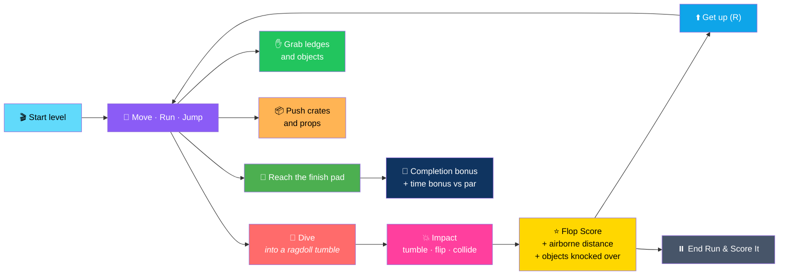
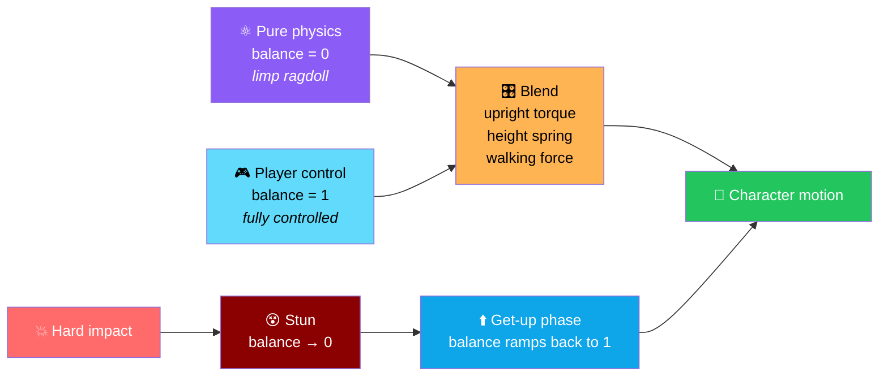

# 🤸 Flop Master

<div align="center">


**A 3D ragdoll physics game about glorious failure.**

*Guide a floppy human through six absurd levels — and score points for spectacular flops as well as for actually finishing.*

[🚀 Run It](#-run-it) • [🎮 Controls](#-controls-all-remappable-in-settings) • [🎯 Gameplay](#-gameplay) • [🏗️ Architecture](#️-architecture) • [🧪 Tests](#-tests)

</div>

---

## 📖 Overview

**Flop Master** is a **3D ragdoll physics game** about **glorious failure**, built in **Godot 4.4** *(GDScript, Jolt Physics)*.

### Core Idea

> **Failing spectacularly is the point.**
>
> Guide a floppy human through six absurd levels — and score points for **spectacular flops** as well as for **actually finishing**.

### The Flop Flow



---

## 🚀 Run It

### 1. Install Godot

**Godot 4.4 or newer** *(standard build, no .NET needed)* — [godotengine.org/download](https://godotengine.org/download)

### 2. Import and Play

1. Open Godot
2. Click **Import**
3. Choose **`project.godot`** in this folder
4. Press **F5**

**Or from a terminal:**

```bash
godot --path .
```

> ✅ **No external assets are required.**
>
> **All sounds and music are synthesized at startup, and all models, levels, and UI are built from code.**

---

## 🎮 Controls *(All Remappable in Settings)*

<div align="center">

| Action | Default | Notes |
|:------:|:-------:|-------|
| **Move** | **W A S D / arrows / left stick** | **Relative to the camera** |
| **Run** | **Shift** | **Faster — but you trip at high speed** |
| **Jump** | **Space** | **Also pulls you up when hanging from a ledge** |
| **Dive** | **C** | **Launches you forward into a ragdoll tumble** |
| **Grab** | **E** *(hold)* | **Grab ledges and objects — drains grip** |
| **Push** | **F** | **Shoves crates and props** |
| **Get up** | **R** | **Stand up sooner** · **Hold `R` to give up and return to the last checkpoint** |
| **Restart level** | **Backspace** | — |
| **Pause** | **Esc** | **Resume · restart · end run and score it · settings · quit** |
| **Camera** | **Mouse** | — |

</div>

---

## 🎯 Gameplay

### ⭐ Flop Score

**Combines:**

- **Airborne distance**
- **Tumbles and flips**
- **Collision intensity**
- **Objects knocked over**
- **Size of falls**
- **Stunt variety**
- **Collectibles**

### 🏆 Ratings

<div align="center">

| Rating | What It Means |
|:------:|--------------|
| *Mildly Wobbly* | A gentle stumble |
| *Human Noodle* | Real flop energy |
| *Professional Disaster* | Commitment to the fall |
| *Certified Catastrophe* | Peak flop |
| **Flop Master Supreme** | The full send |

</div>

### 🏁 Finishing

> **Finishing a level adds a completion bonus plus a time bonus against the level's par time** — **so failing spectacularly never beats actually finishing.**

### ⏸️ End Run & Score It

> **Pausing → "End Run & Score It"** lets you **bank a glorious failure without finishing**.

### 🗺️ Six Levels

<div align="center">

| # | Level |
|:-:|-------|
| 1 | **Training Room** |
| 2 | **Slippery Rooftops** |
| 3 | **Construction Chaos** |
| 4 | **Giant Fan Factory** |
| 5 | **Moving Platform Madness** |
| 6 | **Ultimate Flop Arena** |

</div>

**Each has:**

- **Checkpoints**
- **Hazards**
- **Rings to collect**
- **A finish pad**

> 💡 **Levels unlock in order.**

### 📈 Progression

<div align="center">

| Feature | Details |
|:-------:|---------|
| **🏅 Medals** | **Bronze · Silver · Gold per level** |
| **📊 Personal Bests** | Tracked per level |
| **🏆 11 Achievements** | Unlocked across runs |
| **🪙 Coins** | To buy outfits and hats |
| **📅 Daily Stunt Challenge** | **Deterministic** — **same goal for everyone each date** |

</div>

### 🛤️ Surface Behavior

<div align="center">

| Surface | Behavior |
|:-------:|----------|
| **Rubber** | **Bounces** |
| **Ice** | **Slippery** |
| **Metal** | **Rings** |
| **Wood and stone** | **Grips** |
| **Soft pads** | **Absorb** |

</div>

---

## 🏗️ Architecture

### System Overview

```mermaid
flowchart TB
    subgraph CONFIG["⚙️ Config"]
        Physics["config/physics.json<br/><em>all tunable parameters</em><br/>character · camera<br/>materials · scoring"]
    end

    subgraph AUTOLOAD["🔌 Autoloads"]
        ConfigA["Config"]
        SaveData["SaveData<br/><em>user://save.json</em>"]
        InputCfg["InputConfig"]
        Audio["AudioManager"]
        Progress["Progression"]
        Scoring["ScoreManager"]
        LevelMgr["LevelManager"]
    end

    subgraph CHARACTER["🤸 Character"]
        Ragdoll["Ragdoll<br/>11 bodies + joints"]
        Controller["CharacterController<br/>balance/recovery"]
        Grab["GrabHandler"]
        Stuck["StuckGuard"]
        Surfaces["SurfaceMaterials"]
    end

    subgraph CAMERA["🎥 Camera"]
        Follow["FollowCamera<br/>smoothing · speed-based framing<br/>shake · wall avoidance"]
    end

    subgraph LEVELS["🗺️ Levels"]
        Base["LevelBase helpers"]
        Six["6 level builders"]
    end

    subgraph HAZARDS["💥 Hazards"]
        Beam["SwingingBeam"]
        Fan["FanUpdraft"]
        Platform["MovingPlatform"]
        Dropper["CrateDropper"]
    end

    subgraph UI["🖥️ UI"]
        Kit["UiKit"]
        Menu["MainMenu"]
        HUD["Hud"]
        Pause["PauseMenu"]
        Results["ResultsScreen"]
        Settings["SettingsPanel"]
    end

    subgraph GAMEPLAY["🎮 Gameplay"]
        Wires["gameplay.gd<br/>checkpoints · respawn · finishing"]
    end

    CONFIG --> AUTOLOAD
    AUTOLOAD --> CHARACTER
    CHARACTER --> CAMERA
    CAMERA --> LEVELS
    LEVELS --> HAZARDS
    HAZARDS --> UI
    UI --> GAMEPLAY

    style CONFIG fill:#61DAFB,color:#000
    style AUTOLOAD fill:#8B5CF6,color:#fff
    style CHARACTER fill:#FF6B6B,color:#fff
    style CAMERA fill:#0EA5E9,color:#fff
    style LEVELS fill:#22C55E,color:#fff
    style HAZARDS fill:#FFB454,color:#000
    style UI fill:#FF3F9E,color:#fff
    style GAMEPLAY fill:#0f3460,color:#fff
```



### 📂 Project Layout

```
flop-master/
├── config/
│   └── physics.json         All tunable character, camera, material
│                            and scoring parameters
│
├── scenes/                  main.tscn (front end)
│                            gameplay.tscn (one run)
│
├── scripts/
│   ├── autoload/            Config · SaveData · InputConfig
│   │                        AudioManager · Progression
│   │                        ScoreManager · LevelManager
│   ├── character/           Ragdoll (11 bodies + joints)
│   │                        CharacterController (balance/recovery)
│   │                        GrabHandler · StuckGuard
│   │                        SurfaceMaterials
│   ├── camera/              FollowCamera
│   │                        (smoothing, speed-based framing,
│   │                         shake, wall avoidance)
│   ├── levels/              LevelBase helpers + six level builders
│   ├── hazards/             SwingingBeam · FanUpdraft
│   │                        MovingPlatform · CrateDropper
│   ├── ui/                  UiKit · MainMenu · Hud · PauseMenu
│   │                        ResultsScreen · SettingsPanel
│   └── gameplay.gd          Wires a run together
│                            (checkpoints, respawn, finishing)
│
└── tests/                   Headless tests + screenshot tool
```

### 🎛️ Tuning

> **Edit `config/physics.json`** — **no code changes are needed to adjust:**
>
> - Speeds
> - Jump height
> - Stun thresholds
> - Camera feel
> - Surface friction and bounce
> - Scoring weights

**Save data lives in:** `user://save.json`

### 🤸 How the Ragdoll Works

> **This is the heart of Flop Master.**

<div align="center">

| Component | Implementation |
|:---------:|---------------|
| **11 rigid bodies** | **Joined by cone-twist joints** *(spine, neck, shoulders, hips)* **and hinge joints** *(elbows, knees)* — **all with limits** |
| **Balance value** | **From 0 (limp) to 1 (fully controlled)** — **blends player control with pure physics** |
| **What balance applies** | **Upright torque · a height spring · walking force scaled by the body's mass** |
| **Stun** | **Hard impacts knock balance to zero** — **then a get-up phase ramps it back** |
| **StuckGuard** | **Records the last safe standing spot** and **rescues the character if it ends up inside geometry or wedged** — **so physics accidents never soft-lock a run** |

</div>

### The Balance Blend



### Design Principles

<div align="center">

| Principle | Implementation |
|:---------:|---------------|
| **🤸 Physics is the game** | **The ragdoll is not a punishment** — **it's the medium** |
| **🎛️ Balance is a dial** | **A single `balance` value blends player control with pure physics** — **stun drops it, get-up restores it** |
| **🛡️ No soft-locks** | **`StuckGuard`** **records the last safe standing spot** and **rescues wedged characters** |
| **🎯 Flops matter** | **Flop Score rewards spectacular failures** — **but finishing still pays better** |
| **⏸️ End on your terms** | **Pause → End Run & Score It** — **bank a glorious failure whenever you want** |
| **🎛️ All tuning in one file** | **`config/physics.json`** — **no code changes needed** |
| **🎨 Zero assets** | **All models, levels, UI, sounds, and music are built from code** |
| **📅 Daily challenge is fair** | **Deterministic — same goal for everyone each date** |
| **🧪 Headless tests** | **Stability, traversal, and a 76-check integration test** |

</div>

---

## 🧪 Tests

```bash
./run_tests.sh
```

### What Runs Headless

<div align="center">

| Test | Coverage |
|:----:|:--------:|
| **Ragdoll stability** | **A drop test proving the ragdoll settles** |
| **Traversal** | **Launch pads, fan lifts, the dive gap, and the ledge mantle are all physically possible** |
| **76-check integration test** | **Menus · all six levels · random-input stress** *(no explosions or NaNs)* · **movement · jump · dive · recovery** · **scoring · checkpoints · respawn** · **level completion · medals · unlocks** · **shop · saving round-trips** · **the daily challenge** · **the stuck guard · pause** |

</div>

### 📸 Screenshots

> **Requires a real renderer** *(e.g. under Xvfb)*.

```bash
xvfb-run -a godot --path . --rendering-method gl_compatibility res://tests/screenshot.tscn -- /some/dir
```

---

## ⚠️ Notes and Limits

> **These are stated honestly by the author.**

<div align="center">

| Limit | Details |
|:-----:|---------|
| **🎮 Gamepad feel untested** | **Verified headlessly and with software-rendered screenshots** — **but not played with a real gamepad or a real audio device** — **controller feel and the synthesized sound mix are untested** |
| **🏁 Completability verified per mechanic** | **Scripted runs across each launch pad, fan, gap, and ledge** — **not by a full bot playthrough of every level** |
| **📦 No export presets** | **Export templates must be installed through the Godot editor** |
| **🎨 All visuals are primitive shapes** | **All audio is procedural** — **swap real meshes or sounds in by assigning `AudioManager.sounds[name]` or replacing meshes in `ragdoll.gd` / level scripts** |

</div>

---

## 🗺️ Roadmap

### ✅ Current

- [x] Godot 4.4 with GDScript and Jolt Physics
- [x] 3D ragdoll character with 11 rigid bodies
- [x] Cone-twist and hinge joints with limits
- [x] Balance system that blends player control with pure physics
- [x] Stun on hard impacts with get-up phase
- [x] `StuckGuard` that prevents soft-locks
- [x] Move, run, jump, dive, grab, push, and get-up controls
- [x] Hold `R` to give up and return to the last checkpoint
- [x] Camera-relative movement
- [x] FollowCamera with smoothing, speed-based framing, shake, and wall avoidance
- [x] **Six levels** — Training Room, Slippery Rooftops, Construction Chaos, Giant Fan Factory, Moving Platform Madness, Ultimate Flop Arena
- [x] Checkpoints, hazards, rings to collect, and finish pads in every level
- [x] Sequential level unlocking
- [x] **Flop Score** combining airborne distance, tumbles, flips, collision intensity, objects knocked over, fall size, stunt variety, and collectibles
- [x] Five ratings from *Mildly Wobbly* to *Flop Master Supreme*
- [x] Completion bonus plus time bonus against par
- [x] **End Run & Score It** in the pause menu
- [x] **Medals** — bronze, silver, and gold per level
- [x] **Personal bests** tracked per level
- [x] **11 achievements**
- [x] **Coins** to buy outfits and hats
- [x] **Deterministic Daily Stunt Challenge**
- [x] **Surface behavior** — rubber bounces, ice slips, metal rings, wood and stone grip, soft pads absorb
- [x] **Hazards** — swinging beams, fan updrafts, moving platforms, crate droppers
- [x] **All tuning in `config/physics.json`**
- [x] **Save data in `user://save.json`**
- [x] **All sounds and music synthesized at startup**
- [x] **All models, levels, and UI built from code**
- [x] **All controls remappable in Settings**
- [x] **Headless ragdoll stability test**
- [x] **Headless traversal test**
- [x] **76-check headless integration test**
- [x] **Screenshot tool** for Xvfb
- [x] **Zero external assets**

### 🔜 Future Ideas

- [ ] **Real gamepad testing** — verify controller feel
- [ ] **Real audio device testing** — verify the synthesized sound mix
- [ ] **Full bot playthrough of every level** — beyond per-mechanic verification
- [ ] **Export presets** — for one-command builds
- [ ] **Real meshes** — replacing the current primitive shapes
- [ ] **Real sounds** — replacing the current synthesized audio
- [ ] **Additional levels** beyond the current six
- [ ] **Additional achievements** beyond the current 11
- [ ] **Additional outfits and hats**
- [ ] **Replay system** — review your best flops

---

## 🤝 Contributing

Contributions are welcome. Please:

1. Fork the repository
2. **Keep tuning in `config/physics.json`** — no code changes for balance or feel
3. **Keep the balance system** — player control and pure physics must blend, not switch
4. **Preserve `StuckGuard`** — physics must never soft-lock a run
5. **Keep finishing worth more than flopping** — that's the design
6. **Keep the daily challenge deterministic** — same goal for everyone each date
7. **Keep everything procedural** — no required external assets
8. **Run `./run_tests.sh`** before submitting
9. **Report gamepad or audio issues** — those paths haven't been tested with real hardware
10. Submit a Pull Request

### Guidelines

- **Never claim a level is completable** without a traversal or bot test
- **Never break the save format** without a migration path
- **Never remove `StuckGuard`** — soft-locks are unacceptable
- **Never make flops worth more than finishing**
- **Never present a stub as a feature** — the **Notes and Limits** section is the standard

---

## 📜 License

MIT — see [LICENSE](LICENSE) for details.

---

## 🙏 Acknowledgments

- **Godot and Jolt Physics** — for making a ragdoll feel this good
- **Every player who's ever laughed at their own spectacular failure** — this one's for you

---

<div align="center">

### 🤸 RUN. TRIP. TUMBLE. FLOP.

**A 3D ragdoll physics game about glorious failure.**

**Fail spectacularly. Finish anyway. Become Flop Master Supreme.**

<br>

> ⚠️ **Verified headlessly — gamepad feel and audio mix untested with real hardware.**

<br>

⭐ If Flop Master made you laugh at yourself, consider giving it a star.

<br>

[⬆ Back to Top](#-flop-master)

</div>
